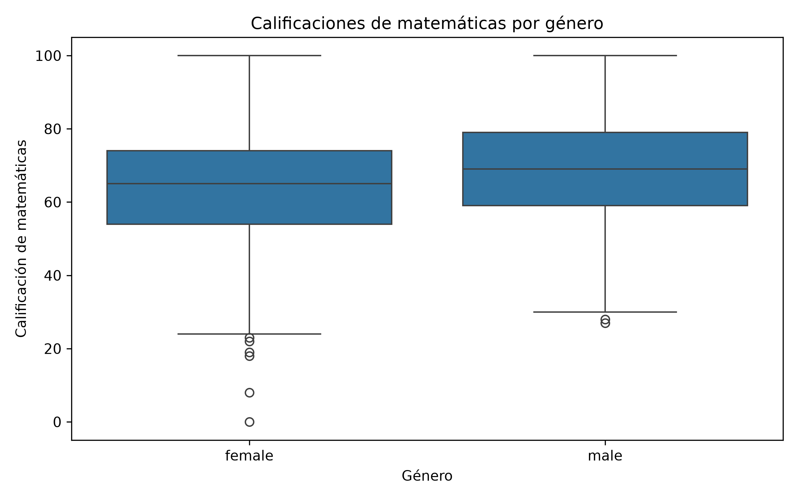
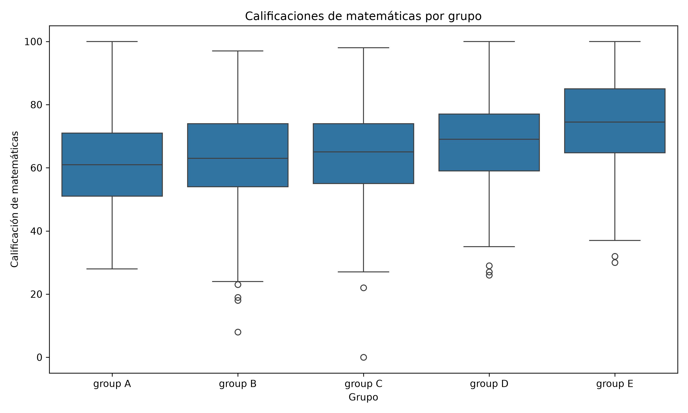
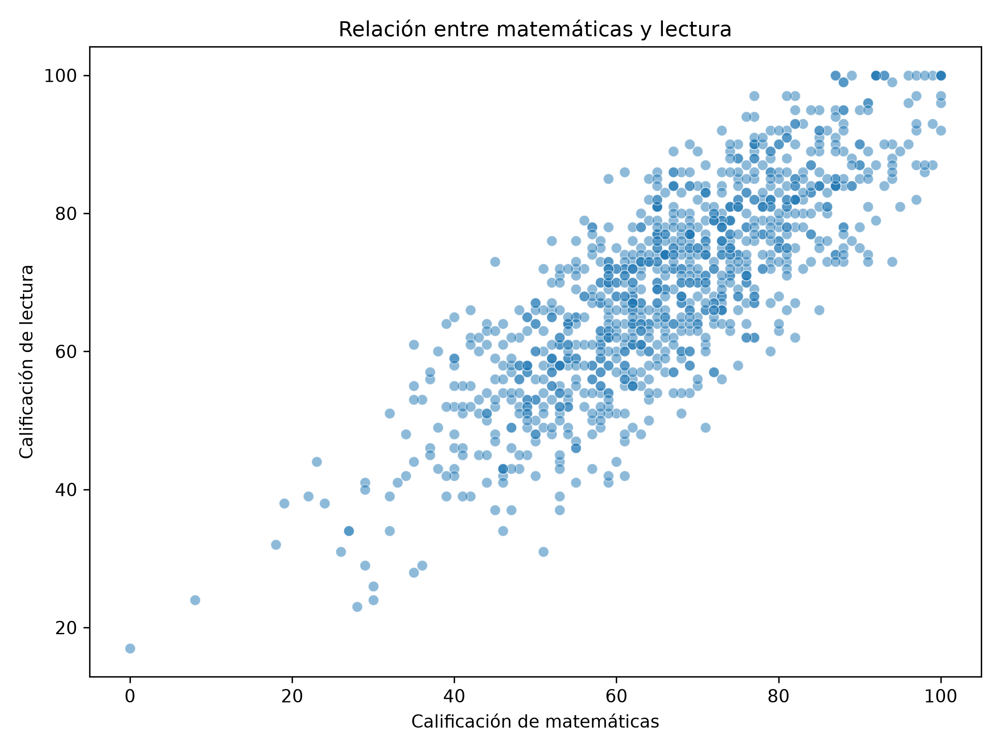
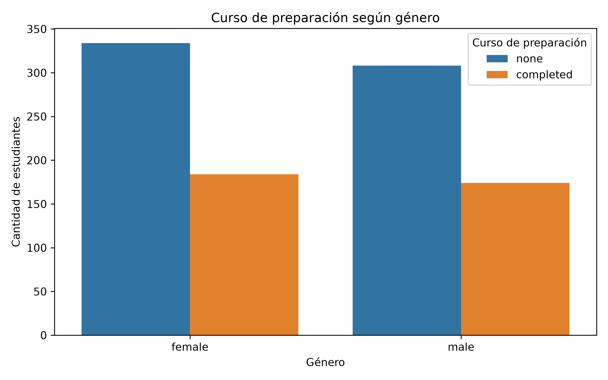

# Análisis estadístico de rendimiento académico con Python

Proyecto de análisis exploratorio e inferencial del conjunto de datos **Students Performance in Exams**, desarrollado en Python. Se estudian las calificaciones de **1.000 estudiantes** en matemáticas, lectura y escritura, y su relación con variables categóricas como género, grupo étnico y preparación para exámenes.

El proyecto aplica pruebas de normalidad, comparaciones entre grupos independientes y relacionados, correlación y asociación entre variables categóricas. Incluye visualizaciones para facilitar la interpretación.

> **Fuente de los datos:** [Students Performance in Exams — Kaggle](https://www.kaggle.com/datasets/spscientist/students-performance-in-exams). Los resultados de este README corresponden a la ejecución realizada con `StudentsPerformance.csv` y un nivel de significancia de **α = 0,05**.

## 1. Objetivos

**Objetivo general:** analizar el rendimiento académico de los estudiantes mediante técnicas estadísticas descriptivas e inferenciales implementadas en Python.

**Objetivos específicos:**

- Explorar el conjunto de datos y resumir las calificaciones.
- Evaluar supuestos estadísticos y seleccionar pruebas apropiadas.
- Comparar las calificaciones entre géneros, grupos y asignaturas.
- Analizar la correlación entre matemáticas y lectura.
- Examinar la independencia entre género y preparación para exámenes.
- Representar los resultados mediante gráficas y comunicar conclusiones.

## 2. Datos utilizados

El archivo `StudentsPerformance.csv` contiene **1.000 filas y 8 columnas**:

| Columna | Descripción | Tipo |
|---|---|---|
| `gender` | Género del estudiante | Categórica |
| `race/ethnicity` | Grupo identificado de A a E | Categórica |
| `parental level of education` | Nivel educativo de los padres | Categórica |
| `lunch` | Tipo de almuerzo | Categórica |
| `test preparation course` | Estado del curso de preparación | Categórica |
| `math score` | Calificación de matemáticas | Numérica |
| `reading score` | Calificación de lectura | Numérica |
| `writing score` | Calificación de escritura | Numérica |

## 3. Estructura del proyecto

```text
DataEstadistico/
├── main.py
├── StudentsPerformance.csv
├── README.md
├── imagenes/
│   ├── grafica_matematicas.png
│   ├── grafica_cinco_grupos.png
│   ├── grafica_correlacion.png
│   └── grafica_chi_cuadrado.png
└── .venv/                     # Entorno local; no subir a GitHub
```

> Las imágenes aparecerán cuando se ejecute el código que las genera. Si alguna todavía no existe, su referencia en este README se mostrará como un enlace sin imagen hasta generarla.

## 4. Requisitos e instalación

Se utiliza **Python 3** y las siguientes bibliotecas:

| Biblioteca | Función |
|---|---|
| `pandas` | Lectura y análisis del CSV |
| `scipy` | Pruebas estadísticas |
| `matplotlib` | Creación y guardado de figuras |
| `seaborn` | Gráficas estadísticas |
| `scikit-posthocs` | Prueba post hoc de Dunn |

En una terminal de Ubuntu/WSL, dentro de `DataEstadistico`:

```bash
# Crear un entorno virtual si todavía no existe
python3 -m venv .venv

# Instalar dependencias dentro del entorno
.venv/bin/python -m pip install pandas scipy matplotlib seaborn scikit-posthocs

# Ejecutar el análisis
.venv/bin/python main.py
```

Si ya existe `.venv`, no es necesario volver a crearlo. La variante de ANOVA de Welch mediante `stats.f_oneway(..., equal_var=False)` requiere SciPy 1.15 o posterior.

## 5. Explicación general del código

El archivo `main.py` realiza las siguientes operaciones, en el orden en que se desarrolló el proyecto:

1. **Importa las bibliotecas** necesarias.
2. **Carga el CSV** con `pd.read_csv()` y muestra `head()` y `shape`.
3. **Separa los datos por género** y comprueba normalidad con Shapiro-Wilk.
4. **Compara hombres y mujeres** mediante Mann-Whitney U.
5. **Calcula estadísticas descriptivas** (`count`, `mean`, `median`, `std`).
6. **Compara cinco grupos** mediante Shapiro-Wilk, Levene y Kruskal-Wallis; aplica Dunn con corrección de Bonferroni.
7. **Compara dos calificaciones del mismo estudiante** mediante Wilcoxon para muestras pareadas.
8. **Estudia la relación** entre matemáticas y lectura con Spearman.
9. **Analiza dos variables categóricas** mediante chi-cuadrado de independencia.
10. **Genera gráficas** y las guarda en formato PNG dentro de `imagenes/`.

### Fragmentos fundamentales

**Lectura y descripción inicial:**

```python
import pandas as pd                # Leer y manipular tablas
from scipy import stats            # Aplicar pruebas estadísticas
import matplotlib.pyplot as plt    # Crear y guardar figuras
import seaborn as sns              # Crear visualizaciones estadísticas
import scikit_posthocs as sp       # Realizar comparaciones post hoc

df = pd.read_csv("StudentsPerformance.csv")  # Cargar datos
print(df.head())                             # Mostrar cinco registros
print(df.shape)                              # Mostrar filas y columnas
```

**Prueba para dos grupos independientes:**

```python
hombres = df.loc[df["gender"] == "male", "math score"]      # Notas de hombres
mujeres = df.loc[df["gender"] == "female", "math score"]  # Notas de mujeres
resultado = stats.mannwhitneyu(hombres, mujeres, alternative="two-sided")  # Contraste bilateral
print(resultado.statistic, resultado.pvalue)  # Mostrar U y p-valor
```

**Prueba para cinco grupos y comparaciones posteriores:**

```python
grupos = [g["math score"].to_numpy() for _, g in df.groupby("race/ethnicity")]  # Crear grupos
kruskal = stats.kruskal(*grupos)  # Contrastar distribuciones
print(kruskal.statistic, kruskal.pvalue)  # Mostrar H y p-valor

dunn = sp.posthoc_dunn(
    df, val_col="math score", group_col="race/ethnicity", p_adjust="bonferroni"
)  # Comparar cada pareja con ajuste por comparaciones múltiples
print(dunn)  # Mostrar matriz de p-valores ajustados
```

**Muestras pareadas, correlación e independencia:**

```python
wilcoxon = stats.wilcoxon(df["math score"], df["reading score"])  # Notas del mismo alumno
spearman = stats.spearmanr(df["math score"], df["reading score"])  # Asociación monotónica

tabla = pd.crosstab(df["gender"], df["test preparation course"])  # Tabla de frecuencias
chi2, p, gl, esperados = stats.chi2_contingency(tabla)  # Prueba de independencia
```

Estos son **fragmentos explicativos**, no un reemplazo completo de `main.py`. El código principal conserva las validaciones, los mensajes de interpretación y las gráficas.

## 6. Pruebas estadísticas y resultados

### 6.1. Normalidad: Shapiro-Wilk

Se evaluó la distribución de las calificaciones de matemáticas por género:

| Grupo | p-valor | Interpretación al 5 % |
|---|---:|---|
| Hombres | 0,038018 | Se rechaza normalidad |
| Mujeres | 0,003510 | Se rechaza normalidad |

El rechazo de normalidad motivó el uso de Mann-Whitney U en el ejercicio didáctico. Con muestras grandes también puede ser razonable analizar las medias con métodos paramétricos robustos, según el objetivo y los supuestos.

### 6.2. Mann-Whitney U: matemáticas por género

- **H₀:** ambas poblaciones tienen la misma distribución de calificaciones.
- **U:** 147.907,5.
- **p-valor:** 4,279 × 10⁻⁷.
- **Decisión:** rechazar H₀.

| Género | Cantidad | Media | Mediana | Desviación estándar |
|---|---:|---:|---:|---:|
| Mujeres | 518 | 63,63 | 65 | 15,49 |
| Hombres | 482 | 68,73 | 69 | 14,36 |

**Interpretación:** se identificaron diferencias significativas entre las distribuciones de las calificaciones. En esta muestra, el promedio de los hombres fue aproximadamente **5,10 puntos mayor**. Una diferencia estadística no demuestra que el género cause el resultado.

### 6.3. Kruskal-Wallis: comparación de cinco grupos

Normalidad de matemáticas por `race/ethnicity`:

| Grupo | p-valor de Shapiro-Wilk |
|---|---:|
| A | 0,854532 |
| B | 0,010389 |
| C | 0,017415 |
| D | 0,059268 |
| E | 0,018494 |

- **Levene:** p = 0,669737; no se detectaron diferencias significativas entre las varianzas.
- **Kruskal-Wallis:** H = 57,0793; p = 1,191 × 10⁻¹¹.
- **Decisión:** rechazar H₀; al menos una distribución difiere.

**Dunn con corrección de Bonferroni:**

| Comparación | p-valor ajustado | Significativa (α = 0,05) |
|---|---:|---|
| A–B | 1,00000 | No |
| A–C | 0,67406 | No |
| A–D | 0,00514 | Sí |
| A–E | < 0,00001 | Sí |
| B–C | 1,00000 | No |
| B–D | 0,06504 | No |
| B–E | < 0,00001 | Sí |
| C–D | 0,13084 | No |
| C–E | < 0,00001 | Sí |
| D–E | 0,00087 | Sí |

**Interpretación:** se encontraron cinco comparaciones significativas. El grupo E difiere de todos los demás, pero para establecer la dirección de las diferencias deben examinarse las medianas y las gráficas. Los valores impresos originalmente como `0.00000` estaban redondeados.

### 6.4. Wilcoxon: matemáticas frente a lectura

Se compararon dos notas correspondientes a **los mismos estudiantes**:

| Indicador | Valor |
|---|---:|
| Media de matemáticas | 66,089 |
| Media de lectura | 69,169 |
| Diferencia media (matemáticas − lectura) | −3,080 |
| Shapiro-Wilk de las diferencias (p) | 0,007536 |
| Wilcoxon (W) | 140.794,5 |
| Wilcoxon (p) | 2,387 × 10⁻²⁴ |

**Interpretación:** hay evidencia de diferencias significativas entre las calificaciones pareadas. En promedio, lectura supera matemáticas en **3,08 puntos**. Wilcoxon analiza las diferencias pareadas mediante rangos; la media se presenta como descripción, no como el parámetro que contrasta directamente la prueba.

### 6.5. Spearman: correlación entre matemáticas y lectura

- **Coeficiente ρ:** 0,804064.
- **p-valor:** 1,354 × 10⁻²²⁷.
- **Decisión:** rechazar H₀ de ausencia de asociación monotónica.

**Interpretación:** se observa una **correlación positiva fuerte**: los estudiantes con mayores notas en matemáticas tienden a tener mayores notas en lectura. La correlación no implica causalidad.

### 6.6. Chi-cuadrado: género y curso de preparación

- **H₀:** género y estado del curso de preparación son independientes.
- **χ²:** 0,015529.
- **Grados de libertad:** 1.
- **p-valor:** 0,900827.
- **Frecuencia esperada mínima:** 172,556.
- **Decisión:** no rechazar H₀.

**Interpretación:** no se encontró evidencia suficiente de asociación entre el género y haber completado el curso de preparación. Las frecuencias esperadas son suficientemente grandes para la aproximación habitual de chi-cuadrado. No rechazar H₀ **no prueba** independencia absoluta.

## 7. Gráficas del proyecto

### 7.1. Calificaciones de matemáticas por género

Diagrama de cajas que permite comparar medianas, dispersión y posibles valores atípicos.



**Archivo:** `imagenes/grafica_matematicas.png`.

### 7.2. Matemáticas en los cinco grupos

Diagrama de cajas de las calificaciones de matemáticas según `race/ethnicity`. Ayuda a interpretar la prueba de Kruskal-Wallis y las comparaciones de Dunn.



**Archivo:** `imagenes/grafica_cinco_grupos.png`.

### 7.3. Correlación entre matemáticas y lectura

Gráfica de dispersión donde cada punto representa a un estudiante. Permite observar la tendencia positiva identificada con Spearman.



**Archivo:** `imagenes/grafica_correlacion.png`.

### 7.4. Género y curso de preparación

Gráfica de barras con las frecuencias de estudiantes según género y estado del curso de preparación.



**Archivo:** `imagenes/grafica_chi_cuadrado.png`.

> Para que GitHub muestre las imágenes, los archivos `.png` deben estar dentro de la carpeta `imagenes/` y subidos al repositorio. Antes de generar las figuras, crea la carpeta con `mkdir -p imagenes` desde la raíz del proyecto (o con `Path("imagenes").mkdir(exist_ok=True)` en Python). En cada sección de `main.py`, guarda su figura con la ruta correspondiente, por ejemplo `plt.savefig("imagenes/grafica_matematicas.png", dpi=300)` antes de `plt.show()`.

## 8. Resumen de resultados

| Análisis | Prueba | p-valor | Resultado |
|---|---|---:|---|
| Matemáticas según género | Mann-Whitney U | 4,279 × 10⁻⁷ | Diferencia significativa |
| Matemáticas en cinco grupos | Kruskal-Wallis | 1,191 × 10⁻¹¹ | Diferencia significativa |
| Matemáticas frente a lectura | Wilcoxon pareada | 2,387 × 10⁻²⁴ | Diferencia significativa |
| Matemáticas y lectura | Spearman | 1,354 × 10⁻²²⁷ | Asociación positiva fuerte |
| Género y preparación | Chi-cuadrado | 0,900827 | Asociación no significativa |

## 9. Conclusiones generales

1. Las calificaciones de matemáticas presentan diferencias estadísticamente significativas entre los géneros y entre algunos grupos de `race/ethnicity`.
2. Las notas de lectura son, en promedio, mayores que las de matemáticas y la comparación pareada resulta significativa.
3. Matemáticas y lectura muestran una correlación positiva fuerte, sin que ello establezca una relación causal.
4. No se detectó una asociación significativa entre género y haber completado el curso de preparación.
5. Python facilita la integración de lectura de datos, pruebas estadísticas, interpretación y visualización en un flujo reproducible.

**Limitaciones:** el dataset no debe considerarse representativo de toda la población estudiantil sin información adicional sobre su muestreo. Los p-valores describen evidencia estadística, no tamaños de efecto ni causalidad. Algunas elecciones de pruebas se realizaron para seguir una matriz didáctica y pueden complementarse con diagnósticos gráficos, tamaños de efecto e intervalos de confianza.

## 10. Referencias y documentación

- Kaggle. [Students Performance in Exams](https://www.kaggle.com/datasets/spscientist/students-performance-in-exams).
- Pandas. [Documentación oficial](https://pandas.pydata.org/docs/).
- SciPy. [Statistical functions (`scipy.stats`)](https://docs.scipy.org/doc/scipy/reference/stats.html).
- Matplotlib. [Documentación oficial](https://matplotlib.org/stable/).
- Seaborn. [Documentación oficial](https://seaborn.pydata.org/).
- scikit-posthocs. [Documentación oficial](https://scikit-posthocs.readthedocs.io/).

---

**Proyecto académico desarrollado con Python para el aprendizaje y la aplicación de pruebas estadísticas.**
