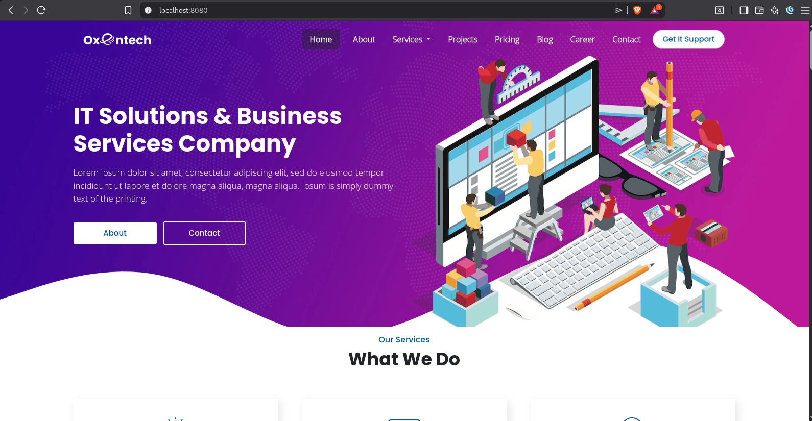

# Documentación del Proyecto Web - PaginaWeb

<div align="center">
  
</div>

Este directorio contiene el código fuente y los recursos estáticos de un sitio web corporativo o de servicios. La estructura del proyecto sugiere que se trata de una plantilla HTML moderna, probablemente para una empresa de tecnología o consultoría, con un enfoque en servicios de TI, desarrollo web, SEO, etc.

## Estructura de Directorios

A continuación, se detalla la organización de los archivos dentro del proyecto.

```text
PaginaWeb/
├── dev/                    # Directorio principal de desarrollo del sitio web
│   ├── css/                # Hojas de estilo (CSS)
│   ├── images/             # Imágenes y recursos gráficos
│   │   └── mycollection/   # Iconos personalizados o de la plantilla
│   ├── js/                 # Scripts de JavaScript
│   ├── webfonts/           # Archivos de fuentes (Font Awesome)
│   ├── *.html              # Archivos HTML y PHP de las diferentes páginas
│   └── contact.php         # Script de procesamiento del formulario de contacto
├── 3e31226c7db7cea3e938240dbcbd4976.zip  # Archivo comprimido (posible copia de seguridad o recurso)
└── docker-compose.yml      # Configuración para entornos Docker
```

## Descripción de Archivos y Directorios Clave

### `dev/`
Es la raíz del sitio web en desarrollo. Contiene todo lo necesario para el funcionamiento del front-end.

- **Archivos raíz (`*.html`, `*.php`)**: Páginas que conforman el sitio.
    - `index.html`: Página de inicio.
    - `about.html`: Página "Acerca de" o "Nosotros".
    - `services.html` (o similares como `itsolution.html`, `networking.html`, `seo.html`, `webdevelopment.html`): Páginas que detallan los servicios ofrecidos.
    - `blog.html` y `blog-details.html`: Listado de artículos y vista de detalle.
    - `career.html` y `career-details.html`: Sección de carreras y ofertas de trabajo.
    - `contact.html` y `contact.php`: Página de contacto y el script que procesa el envío del formulario.
    - `thanks.html` / `thankyou.html`: Página de agradecimiento tras enviar un formulario.
    - `projects.html`, `pricing.html`, `data.html`: Otras secciones comunes.

- **`css/`**:
    Contiene todos los archivos de estilos. Se observa una mezcla de librerías externas (Bootstrap, Owl Carousel, Fancybox, AOS, Font Awesome) y un archivo `style.css` que probablemente contiene las personalizaciones del sitio.

- **`js/`**:
    Similar a `css/`, contiene librerías de JavaScript (`jquery`, `bootstrap`, `owl.carousel`, `mixitup`) y un archivo `custom.js` para la funcionalidad hecha a medida.

- **`images/`**:
    Almacén de todos los recursos gráficos.
    - Logos (`logo.png`, `awd-logo*`).
    - Imágenes de fondo y banners (`banner-pic.jpg`, `bg-banner.jpg`).
    - Iconos de servicios (`web-icon.png`, `seo-icon.png`, `data-icon.png`, etc.), incluyendo versiones para estados "hover".
    - Fotos de stock (`pexels-*.jpeg`, `teacher-11.jpg`).
    - Subdirectorio `mycollection/png/` con iconos numerados (001-folder, 002-search-engine-optimization, etc.), lo que indica que podrían ser iconos personalizados comprados o descargados.

- **`webfonts/`**:
    Archivos de fuentes de iconos (Font Awesome), necesarios para mostrar la iconografía del sitio.

### Archivos en la Raíz (`PaginaWeb/`)

- **`3e31226c7db7cea3e938240dbcbd4976.zip`**: Un archivo comprimido con un nombre hash. Podría ser una copia de seguridad, un recurso sin extraer o un archivo generado automáticamente. Se recomienda revisar su contenido antes de eliminarlo si no es necesario.
- **`docker-compose.yml`**: Indica que el proyecto está preparado para ser desplegado o ejecutado en un entorno Docker, lo que facilita la configuración de un servidor web (como Apache o Nginx con PHP) para servir el sitio.

## Tecnologías Utilizadas

- **Frontend:**
    - HTML5
    - CSS3
    - JavaScript (jQuery)
    - **Librerías CSS/JS:**
        - [Bootstrap](https://getbootstrap.com/) (v4 o v5 por los archivos)
        - [Font Awesome](https://fontawesome.com/) (para iconografía)
        - [Owl Carousel](https://owlcarousel2.github.io/OwlCarousel2/) (carruseles)
        - [Fancybox](https://fancyapps.com/fancybox/3/) (lightbox para imágenes)
        - [AOS (Animate On Scroll)](https://michalsnik.github.io/aos/)
        - (filtrado de portfolios)
- **Backend:**
    - PHP (para el envío de formularios, `contact.php`)

## Cómo Desplegar Usando Docker con Nginx)

> [!TIP]
>  - Asegúrate de tener **Docker** y **Docker Compose** instalados.
> - El archivo **`docker-compose.yml`** incluido en la raíz del proyecto tiene la siguiente configuración:

```yml
      services:
        web:
          image: nginx:alpine
          container_name: mi-primera-pagina
          ports:
            - "8080:80"
          volumes:
            # Tu código fuente
            - ~/Logica2026-1/PaginaWeb/dev:/usr/share/nginx/html
```

Para levantar el contenedor, ejecuta el siguiente comando en la raíz del proyecto (`PaginaWeb/`):

```bash
docker-compose up -d
```

Una vez que el contenedor esté en ejecución, podrás acceder al sitio web desde tu navegador en la dirección: `http://localhost:8080`
    
> [!IMPORTANT]  
>  La configuración monta el código fuente desde **`~/Logica2026-1/PaginaWeb/dev`**. Si tu proyecto no se encuentra en esa ruta exacta, deberás modificar la línea de **`volumes`** en el archivo **`docker-compose.yml`** para que apunte a la ubicación correcta de tu carpeta **`dev`**.


> [!CAUTION]
> Recuerda detener el servicio, donde se encuentre el archivo **`docker-compose.yml`**.

```bash
docker compose down
```
